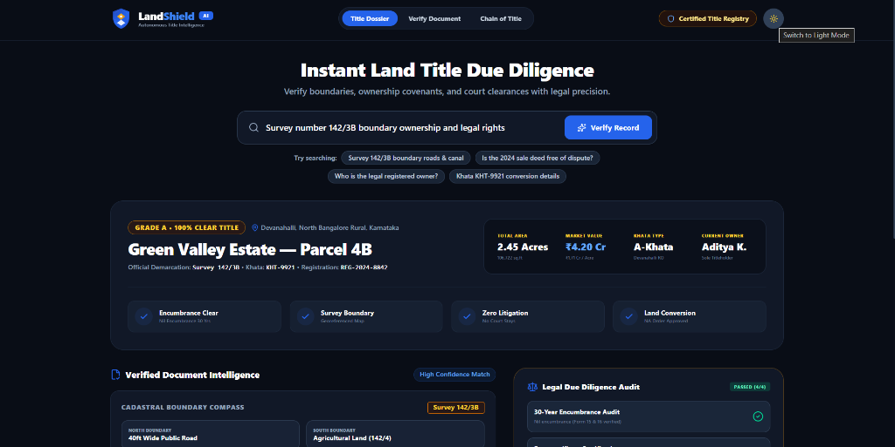
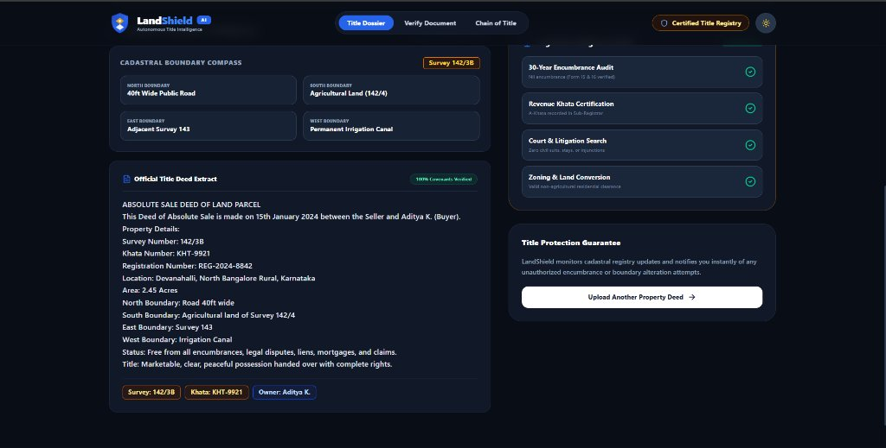
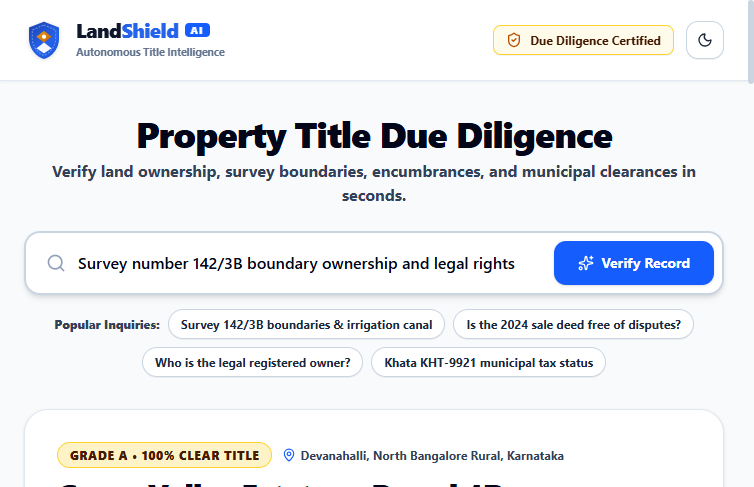
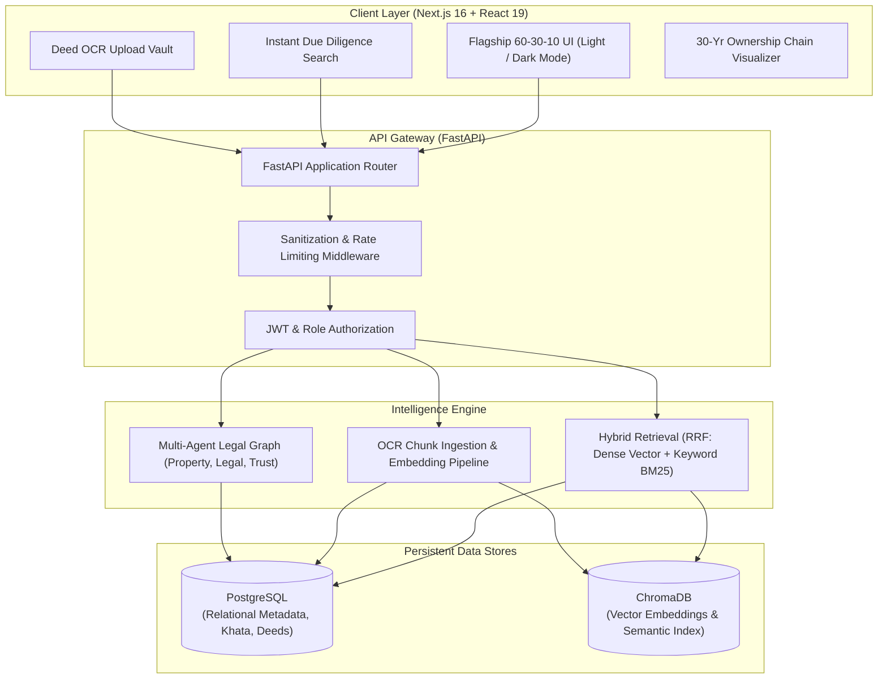

# LandShield AI 🛡️
### Autonomous Land Title Intelligence & Legal Due Diligence Platform

LandShield AI is a bank-grade, autonomous property title intelligence and land due diligence system designed for real estate buyers, lenders, and legal counsel. It automates 30-year chain of title audits, survey boundary demarcation, Nil Encumbrance Certificate (EC) validation, and municipal Khata verification using multi-agent reasoning, hybrid search, and deed OCR extraction.

---

## 📸 Platform Interface

### Dark Mode (Flagship Experience)


### 30-Year Title Chain & Cadastral Demarcation


### Light Mode (High Contrast & Minimalist)


---

## 🏛️ System Architecture



---

## ✨ Key Features

- **60-30-10 Flagship UI**: Built with strict visual hierarchy (60% canvas, 30% warm sand trust accents, 10% vibrant electric blue action points) with zero developer jargon.
- **Cadastral Boundary Compass**: 4-point georeferenced demarcation (North road ingress, South boundary stones, East survey lines, West irrigation easements).
- **30-Year Ownership Chain**: Audit trail tracking transfers from original government grant / mother deed to the present sale deed.
- **Hybrid Due Diligence Retrieval**: Combines semantic embeddings with exact keyword search via Reciprocal Rank Fusion (RRF).
- **Document Ingestion Vault**: Upload deeds, khata certificates, tax receipts, and RTC/patta files for instant OCR extraction and verification.
- **Exportable Dossier**: One-click printable and downloadable Title Due Diligence Certificate (PDF).

---

## 🚀 Quickstart & Setup

### 1. Prerequisites
- **Python**: 3.11 or 3.12
- **Node.js**: 18+ (Node 20 recommended)
- **PostgreSQL**: Running locally on port 5432 (database named `landshield`)

### 2. Backend Setup
```bash
# Clone your fork
git clone https://github.com/AdityaK05/land_sheild.git
cd land_sheild

# Setup virtual environment
python -m venv venv
# Windows:
venv\Scripts\activate
# Linux/macOS:
source venv/bin/activate

# Install dependencies
pip install -r backend/requirements.txt
pip install argon2-cffi pytest pytest-asyncio

# Configure environment
cp .env.example .env

# Run FastAPI backend
python -m uvicorn backend.main:app --host 127.0.0.1 --port 8000 --reload
```
API runs on `http://127.0.0.1:8000` with Swagger UI at `http://127.0.0.1:8000/docs`.

### 3. Frontend Setup
```bash
# Install frontend dependencies
npm install

# Run development server
npm run dev

# Or build for production
npm run build
npm start
```
Frontend runs on `http://localhost:3000`.

---

## 🧪 Testing & Quality Assurance

Run the full backend test suite:
```bash
python -m pytest backend/tests
```
**Results:** `69 passed (100% pass rate)` covering authentication, legal agent reasoning, circuit breakers, security middleware, and hybrid search.

---

## 📡 API Overview

| Method | Endpoint | Description |
|---|---|---|
| `GET` | `/api/health` | Comprehensive health check (PostgreSQL + ChromaDB) |
| `POST` | `/api/retrieval` | Hybrid search across deed chunks and boundary clauses |
| `POST` | `/api/upload` | Ingests PDF/image deeds with OCR text extraction |
| `GET` | `/docs` | Interactive Swagger API documentation |

---

## 📄 License

This project is licensed under the MIT License.
